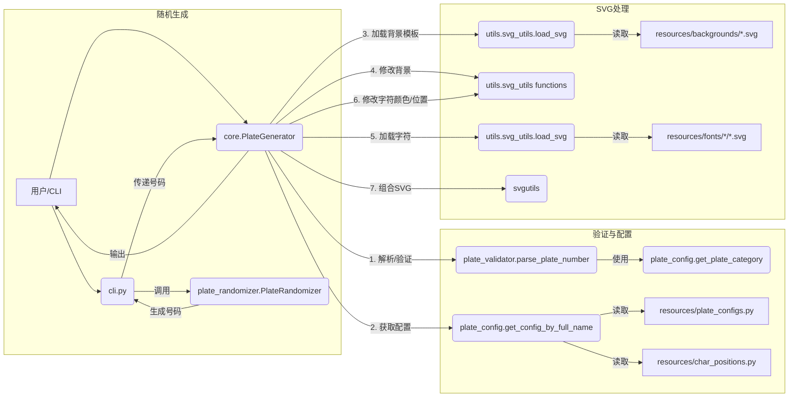

# 车牌生成工具 (plate-gen) 项目文档

## 1. 引言

### 1.1 项目概述

`plate-gen` 是一个基于 Python 的命令行工具，旨在生成符合中国大陆机动车号牌标准的 SVG 格式图像。用户可以通过指定车牌类型、车辆类型和车牌号码来生成特定的车牌图像，或者让工具根据规则随机生成车牌号码并输出图像。

### 1.2 项目目标

*   **真实性:** 生成的车牌在视觉上尽可能接近真实车牌，包括颜色、字体、布局和尺寸比例。
*   **规范性:** 遵循相关标准（如 GA 36-2018 中涉及的车牌号码编码规则）生成和验证车牌号码。
*   **灵活性:** 支持多种常见的车牌类型（普通蓝牌、大型黄牌、新能源绿牌、使领馆牌等）和车型。
*   **可扩展性:** 项目结构清晰，易于添加新的车牌类型或修改现有规则。
*   **易用性:** 提供简单的命令行接口供用户使用。

### 1.3 技术栈

*   **核心语言:** Python 3.x
*   **SVG 处理:** `svgutils` (用于组合 SVG 元素), `lxml` (用于解析和修改 SVG XML)
*   **命令行接口:** `argparse`
*   **测试框架:** `pytest`
*   **类型注解:** Python Typing Hints

## 2. 系统架构

项目采用模块化设计，主要包含以下几个核心部分：

1.  **命令行接口 (CLI):** (`cli.py`) 负责接收用户输入参数，调用核心生成器，并处理输出和异常。
2.  **核心生成器 (Core):** (`core.py`) 包含 `PlateGenerator` 类，是生成车牌 SVG 的核心逻辑单元。它协调配置加载、号码验证、资源查找和 SVG 组装等步骤。
3.  **车牌配置 (Config):** (`plate_config.py`, `resources/plate_configs.py`, `resources/char_positions.py`) 定义 `PlateConfig` 数据类，管理不同类型车牌的配置信息（尺寸、颜色、字体路径、背景路径、字符位置等），并提供根据车牌类型和车辆类型获取具体配置的逻辑。
4.  **车牌验证器 (Validator):** (`plate_validator.py`) 负责验证输入的车牌号码是否符合格式规范，并能将合法的车牌号码解析为其组成部分（省份、发牌机关、序号等）。
5.  **车牌随机生成器 (Randomizer):** (`plate_randomizer.py`) 根据定义的规则随机生成符合规范的车牌号码。
6.  **类型定义 (Types):** (`plate_types.py`) 使用 `typing` 模块定义了项目中使用的各种类型别名和数据结构，增强代码的可读性和健壮性。
7.  **异常处理 (Exceptions):** (`exceptions.py`) 定义了项目特定的异常类，用于更精确地处理错误情况。
8.  **SVG 工具 (Utils):** (`utils/svg_utils.py`) 提供加载、修改（颜色、位置）和操作 SVG 文件（主要是模板文件）的辅助函数。
9.  **资源文件 (Resources):** (`resources/`) 包含生成车牌所需的 SVG 模板（背景、字符字体）和配置文件。

**交互流程:**



## 3. 核心模块详解

### 3.1 `cli.py` - 命令行接口

*   使用 `argparse` 定义命令行参数，包括：
    *   `--type`: 车牌类型 (必需)
    *   `--vehicle`: 车辆类型 (必需)
    *   `--number`: 车牌号码 (可选，不提供则随机生成)
    *   `--output`: 输出 SVG 文件路径 (默认 `outputs/output.svg`)
    *   `--resources`: 资源目录路径 (可选，默认 `resources/`)
    *   `--count`: 随机生成数量 (可选，默认 5，仅在不指定 `--number` 时有效)
    *   `--debug`: 启用调试日志 (可选)
*   初始化日志配置 (`logging`)。
*   实例化 `PlateGenerator`。
*   根据是否提供 `--number` 参数，决定是生成指定号码的车牌还是调用 `PlateRandomizer` 随机生成多个号码。
*   调用 `generator.generate()` 生成 SVG 对象。
*   使用 `svg.save()` 保存 SVG 文件。
*   捕获并处理可能发生的 `InvalidPlateNumberError`, `ResourceNotFoundError` 等异常。

### 3.2 `core.py` - 核心生成器

*   **`PlateGenerator` 类:**
    *   `__init__(resource_dir=None)`: 初始化资源目录路径。优先顺序：环境变量 `PLATE_RESOURCES_DIR` > 构造函数参数 `resource_dir` > 默认路径 (`resources/`)。如果目录不存在，抛出 `ResourceNotFoundError`。
    *   `_get_plate_config(parsed_number)`: 根据 `parse_plate_number` 返回的解析结果，调用 `PlateConfig.get_config_by_full_name` 获取对应的 `PlateConfig` 对象，并确定背景和字体文件的路径。检查资源文件是否存在。
    *   `_prepare_background(plate_full_name, config, bg_file)`: 加载背景 SVG 模板 (`load_svg`)。根据 `config` 中的颜色信息，调用 `svg_utils` 中的函数 (`set_rect_color`, `set_border_and_separator_color`, `set_separator_position`) 修改背景颜色、边框/分隔符颜色和分隔符位置。特别处理新能源车牌，尝试加载预制的渐变背景 (`Car.svg` 或 `Track.svg`)。
    *   `_fill_plate_characters(plate_type, parsed_number, font_dir, config)`: 根据解析后的车牌号码 (`parsed_number`) 和字符位置配置 (`config.char_positions`)，加载对应的字符 SVG 文件 (e.g., `京.svg`, `A.svg`, `1.svg`)。调用 `svg_utils.set_path_color` 设置字符颜色，并使用 `moveto` 将字符放置到正确的位置。处理不同车牌类型（普通、使馆、领馆、新能源）的字符布局。
    *   `generate(plate_type, vehicle, number)`: 公开方法， orchestrates the entire generation process:
        1.  调用 `plate_validator.parse_plate_number` 验证和解析输入号码。
        2.  调用 `_get_plate_config` 获取配置。
        3.  调用 `_prepare_background` 准备背景 SVG。
        4.  调用 `_fill_plate_characters` 获取所有字符的 SVG 元素列表。
        5.  使用 `svgutils` 将字符元素添加到背景 SVG 上。
        6.  返回最终的 `SVGFigure` 对象。

### 3.3 `plate_config.py` - 车牌配置

*   **`PlateConfig` Dataclass:** 存储单个车牌类型的完整配置，包括 `size`, `font_path`, `background_path`, `colors` (字典，如 `{'background': '#RRGGBB', 'text': '#RRGGBB'}`), `char_positions` (字典，包含各部分字符的坐标)。
*   **`get_plate_category(plate_type, vehicle)`:** 类方法，根据用户输入的 `plate_type` 和 `vehicle` 组合，返回一个内部使用的、更具体的车牌分类名称（如 `'小型新能源'`, `'领馆汽车'`, `'普通'` 等）。这个分类名称用于后续在 `PLATE_CONFIG_MAP` 中查找配置。包含对无效组合的验证逻辑 (e.g., 使馆牌不能是新能源)。
*   **`get_config_by_full_name(plate_full_name)`:** 类方法，根据 `get_plate_category` 返回的分类名称，从 `resources.plate_configs.PLATE_CONFIG_MAP` 中查找并返回对应的 `PlateConfig` 实例。
*   **`resources/plate_configs.py`:** 存储 `PLATE_CONFIG_MAP` 字典，将车牌分类名称映射到具体的 `PlateConfig` 实例。
*   **`resources/char_positions.py`:** 可能存储字符位置的预定义常量或字典，供 `plate_configs.py` 引用。

### 3.4 `plate_validator.py` - 车牌验证器

*   **`PLATE_REGEX_MAP`:** 字典，存储不同车牌分类名称对应的正则表达式，用于初步匹配车牌号格式。
*   **`validate_embassy_consulate_serial(plate_type, groups)`:** 验证使领馆车牌的外交代码和序号部分的格式。
*   **`validate_normal_serial(plate_type, groups, special_mark)`:** 验证普通车牌序号部分的字母/数字组合规则（基于 `PlateRandomizer.LETTER_POSITION_RULES` 和 `ENABLED_RULES` 的逻辑，但此处用于验证）和特殊标记（如“警”、“学”）的位置。
*   **`validate_new_energy_serial(plate_type, plate_category, serial_number)`:** 验证新能源车牌序号的特定规则（长度、首位/末位字母要求、纯电/非纯电字母范围、数字/字母组合）。
*   **`validate_serial_pattern(serial, enabled_rules)`:** (未在提供的代码片段中直接显示，但被 `validate_normal_serial` 调用) 检查普通车牌序号是否符合 GA36-2018 定义的 16 种字母数字组合模式中的一种。
*   **`parse_plate_number(plate_type, vehicle, number)`:** 核心验证和解析函数：
    1.  调用 `PlateConfig.get_plate_category` 获取车牌分类。
    2.  根据分类从 `PLATE_REGEX_MAP` 获取正则表达式。
    3.  使用 `re.fullmatch` 进行匹配。
    4.  如果匹配成功，提取匹配组 (`groups`)。
    5.  根据车牌分类，调用相应的详细验证函数 (e.g., `validate_embassy_consulate_serial`, `validate_new_energy_serial`, `validate_normal_serial`) 对序号等部分进行规则校验。
    6.  根据验证结果和车牌类型，构建并返回一个包含解析后各部分的类型化字典 (`ParsedPlateNumber` 的具体子类型，如 `NormalParsedPlateNumber`, `NewEnergyParsedPlateNumber` 等)。
    7.  如果任何步骤失败（正则不匹配、规则校验失败），则抛出 `InvalidPlateNumberError` 或 `ValueError`。

### 3.5 `plate_randomizer.py` - 车牌随机生成器

*   **常量:** `PROVINCES`, `LETTERS`, `NEW_ENERGY_PURE_ELECTRIC`, `NEW_ENERGY_NON_ELECTRIC`。
*   **`PlateRandomizer` 类:**
    *   `LETTER_POSITION_RULES`: 字典，定义了普通蓝牌序号中 16 种字母位置组合规则。
    *   `ENABLED_RULES`: 字典，指定 4 位和 5 位序号分别启用哪些字母位置规则。
    *   `RULES`: 字典，包含不同类型（'blue', 'green_small', 'green_large'）随机生成的配置，如省份权重 (`province_weights`) 和基本模式 (`pattern`)。
    *   `__init__()`: 初始化配置。
    *   `_generate_serial_by_rule(length)`: 根据 `LETTER_POSITION_RULES` 和 `ENABLED_RULES` 随机生成符合规则的 4 位或 5 位普通车牌序号。
    *   `random_blue()`: 生成随机蓝牌号码（省份+发牌机关+4/5位合规序号）。
    *   `random_green_small()`: 生成随机小型新能源车牌号码（省份+发牌机关+首字母+数字/字母组合）。
    *   `random_green_large()`: 生成随机大型新能源车牌号码（省份+发牌机关+数字+末字母）。
    *   `random_green(is_small=None)`: 随机生成小型或大型新能源车牌。
    *   `generate(plate_type, count=1)`: 静态方法，批量生成指定类型的随机车牌号码列表。

### 3.6 `plate_types.py` - 类型定义

*   使用 `typing.Literal` 定义了 `PlateType` 和 `VehicleType`，限制了可接受的字符串值。
*   定义了 `PositionCoord` (坐标元组)。
*   使用 `typing.TypedDict` 定义了 `CharPositionDict` (字符位置配置) 和各种解析结果的数据结构 (`BaseParsedPlateNumber`, `EmbassyParsedPlateNumber`, `ConsulateParsedPlateNumber`, `NormalParsedPlateNumber`, `NewEnergyParsedPlateNumber`)。
*   使用 `typing.Union` 定义了 `ParsedPlateNumber`，作为所有解析结果类型的联合。
*   定义了 `PlateCategoryName`，列出所有内部使用的具体车牌分类名称。
*   这些类型注解提高了代码的清晰度、可维护性，并有助于静态类型检查。

### 3.7 `exceptions.py` - 异常处理

*   `InvalidPlateNumberError(ValueError)`: 车牌号码格式或内容不符合规范时抛出。
*   `ResourceNotFoundError(FileNotFoundError)`: 所需的资源文件（SVG 模板、配置文件）未找到时抛出。
*   `InvalidVehicleComboError(ValueError)`: 用户提供的车牌类型与车辆类型组合无效时抛出。
*   自定义异常使得错误处理更具针对性。

### 3.8 `utils/svg_utils.py` - SVG 工具

*   `load_svg(svg_path)`: 使用 `lxml` 解析 SVG 文件，并返回 `svgutils.transform.SVGFigure` 对象。处理了 `huge_tree=True` 以支持复杂的 SVG。
*   `set_rect_color(svg_figure, fill_color)`: 查找 SVG 中的背景矩形 (`<rect id='background'>` 或备选 XPath)，并设置其 `fill` 属性。使用了命名空间处理。
*   `set_border_and_separator_color(svg_figure, color)`: 查找边框 (`<rect id='border'>`) 和分隔符 (`<circle id='separator'>`) 元素，并设置其 `stroke` 或 `fill` 颜色。
*   `set_separator_position(svg_figure, position)`: (在 `core.py` 中被调用，但未在此处显示) 查找分隔符元素并设置其位置 (`cx`, `cy`)。
*   `set_path_color(svg_figure, color)`: (在 `core.py` 中被调用，但未在此处显示) 查找 SVG 中的所有路径 (`<path>`) 元素，并设置其 `fill` 属性。这主要用于给字符 SVG 上色。

## 4. 资源管理

`resources/` 目录是存放所有生成车牌所需模板和配置的核心位置。

*   **`backgrounds/`:** 存放不同尺寸和类型的车牌背景 SVG 模板。
    *   `440×140.svg`: 标准小型汽车蓝牌/黄牌尺寸。
    *   `220×140.svg`: 标准摩托车牌尺寸。
    *   `480×140/`: 新能源车牌尺寸目录。
        *   `Car.svg`: 小型新能源渐变背景。
        *   `Track.svg`: 大型新能源渐变背景。
    *   其他 SVG 文件可能对应使领馆等特殊牌照的背景。
*   **`fonts/`:** 存放字符形状的 SVG 文件，按颜色或类型分子目录（如 `blue/`, `green/`, `yellow/`）。每个目录下包含单个字符的 SVG 文件 (e.g., `京.svg`, `A.svg`, `1.svg`)。这些文件只包含字符的路径信息，颜色和位置在 `core.py` 中动态应用。
*   **`plate_configs.py`:** 定义 `PLATE_CONFIG_MAP`，将内部车牌分类名称映射到 `PlateConfig` 对象，包含尺寸、颜色、使用的背景模板路径、字体目录路径和字符位置信息。
*   **`char_positions.py`:** 定义不同车牌布局下各字符的精确坐标。

`PlateGenerator` 在初始化时确定资源目录，并在生成过程中根据 `PlateConfig` 加载相应的背景和字符 SVG 模板。

## 5. 标准符合性 (GA 36-2018)

项目在多个方面尝试遵循中国机动车号牌的相关标准，主要体现在：

*   **号码结构与格式:** `plate_validator.py` 中的正则表达式和验证逻辑严格按照不同类型车牌（普通、新能源、使领馆）的号码构成规则进行校验。
*   **字符集:** 使用 `LETTERS` 常量排除了字母 'I' 和 'O'。新能源号牌的特定字母（D, A, B, C, E, F, G, H, J, K）也在验证和生成中被正确使用。
*   **普通号牌序号规则:** `plate_randomizer.py` 在生成蓝牌序号时，以及 `plate_validator.py` 在验证时，都考虑了 GA36-2018 中定义的 16 种字母数字组合规则。
*   **新能源号牌序号规则:** 对小型（首位字母+数字/字母组合）和大型（数字+末位字母）新能源号牌的特殊序号规则进行了实现和验证。
*   **视觉元素 (部分):**
    *   **颜色:** `plate_configs.py` 中定义了不同车牌类型的主要背景色和文字颜色（如蓝底白字、黄底黑字、绿底黑字、黑底白字）。
    *   **布局:** `char_positions.py` 和 `plate_configs.py` 定义了字符的相对位置，包括省份、发牌机关、序号、分隔符等。
    *   **字体:** 使用 SVG 格式的字体文件来模拟车牌专用字体。
    *   **尺寸:** `plate_configs.py` 中定义了不同车牌的尺寸（像素单位）。
    *   **新能源渐变:** `core.py` 中特别处理了新能源车牌，加载预制的渐变背景 SVG。

**注意:** SVG 生成的视觉效果依赖于模板文件的准确性和 `svgutils` 的渲染能力，可能与实际物理车牌存在细微差异。标准的符合性主要集中在号码编码规则和主要的视觉元素上。

## 6. 使用说明

通过命令行执行 `cli.py`：

```bash
python cli.py --type <车牌类型> --vehicle <车辆类型> [--number <车牌号码>] [--output <输出路径>] [--resources <资源路径>] [--count <数量>] [--debug]
```

**示例:**

*   生成指定的普通小型汽车车牌：
    ```bash
    python cli.py --type 普通 --vehicle 汽车 --number 京A12345 --output plates/京A12345.svg
    ```
*   随机生成 10 个小型新能源车牌：
    ```bash
    python cli.py --type 普通 --vehicle 新能源 --count 10 --output outputs/new_energy_#.svg  # 注意：输出文件名需要手动处理或修改cli.py以支持模板
    ```
*   生成指定的使馆汽车车牌：
    ```bash
    python cli.py --type 使馆 --vehicle 汽车 --number 123456使
    ```

## 7. 测试

项目包含使用 `pytest` 编写的单元测试：

*   `test_plate_config.py`: 测试 `PlateConfig` 类和 `get_plate_category` 等相关功能。
*   `test_plate_generator.py`: 测试 `PlateGenerator` 的初始化、内部方法和 `generate` 方法，覆盖不同车牌类型和异常情况。使用了 `unittest.mock.patch` 来模拟文件系统操作和依赖项。
*   `test_plate_validator.py`: 测试 `parse_plate_number` 函数，覆盖各种有效和无效的车牌号码、类型组合以及边界条件。使用了 `@pytest.mark.parametrize` 来测试多种序号模式。
*   `test_randomizer.py`: 测试 `PlateRandomizer` 生成的号码是否能通过 `plate_validator` 的验证。

测试确保了核心逻辑的正确性和代码的健壮性。

## 8. 总结与展望

`plate-gen` 项目成功实现了一个功能相对完善的车牌 SVG 生成工具，能够根据规则生成多种类型的、符合主要标准的中国车牌图像。代码结构清晰，模块化程度高，并配有单元测试。

**潜在的改进方向:**

*   **更精细的视觉效果:** 引入更复杂的 SVG 特效（如纹理、反光、立体感）以提高真实感。
*   **配置完善:** 补充或修正 `plate_configs.py` 和 `char_positions.py` 中的数据，确保覆盖所有车牌类型和细节。
*   **Web 界面:** 开发一个 Web 应用，提供图形化界面进行车牌生成。
*   **批量输出:** 改进 `cli.py` 以支持更灵活的批量输出文件名模板。
*   **标准更新:** 跟踪并实现未来可能出现的车牌标准变更。
*   **性能优化:** 对于大量生成场景，分析并优化 SVG 处理和文件 I/O 性能。
。